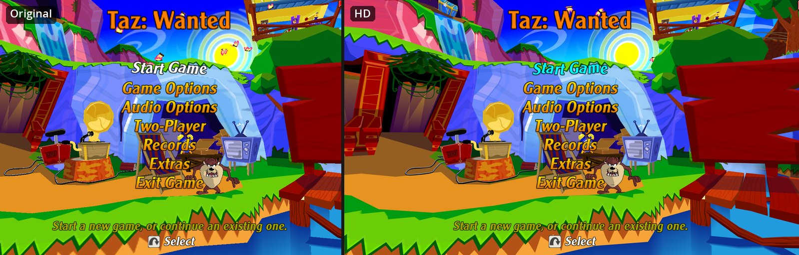
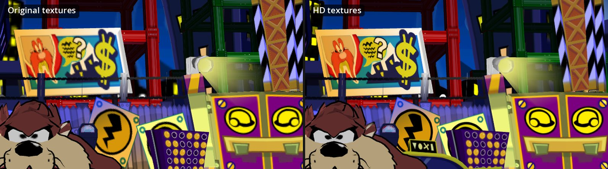
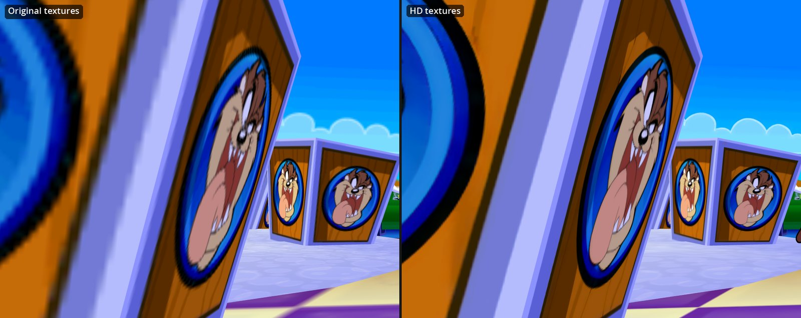
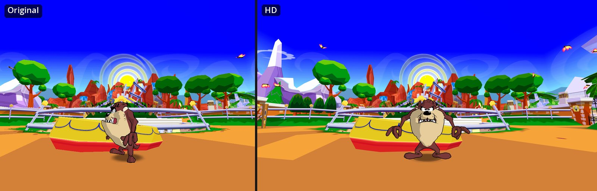
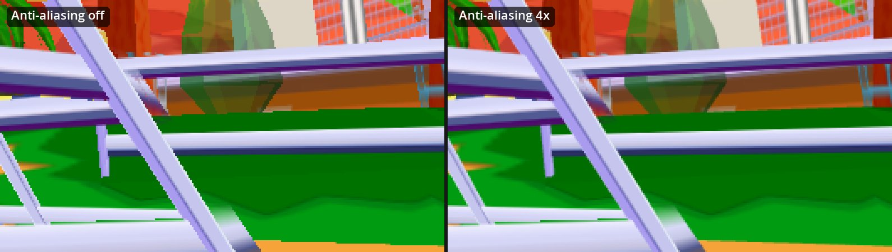
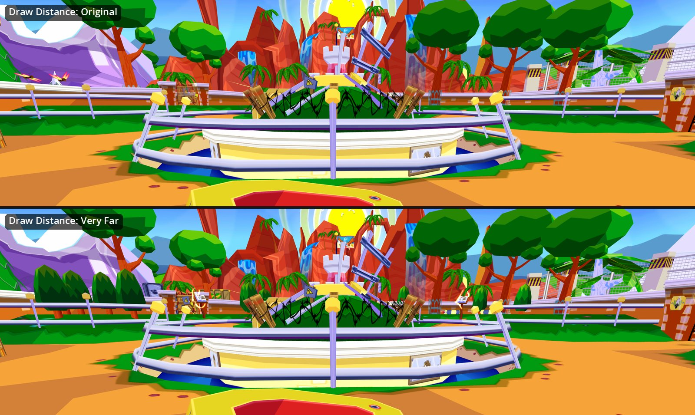
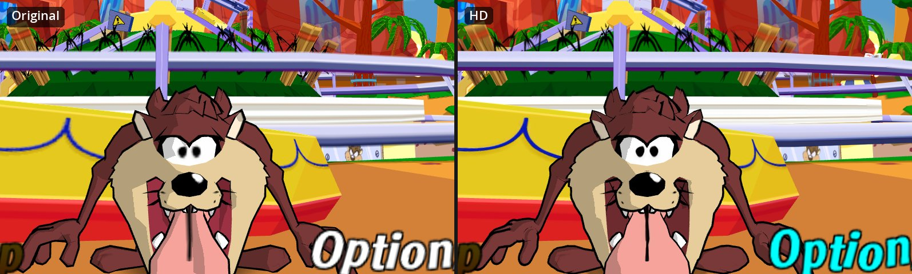
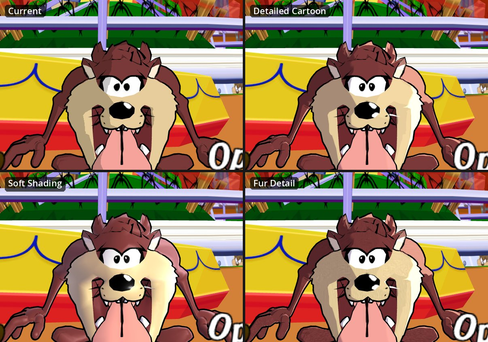
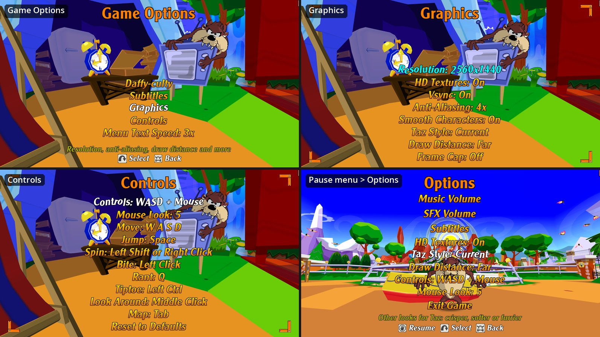

# Taz: Wanted HD

An unofficial fan remaster mod for the 2002 PC game Taz: Wanted. You bring the game.

- Quicksave (F5) and quickload (F9) anywhere in a level.
- WASD to move and the mouse to turn the camera, with every key remappable.
- HD graphics: 4x upscaled textures, widescreen at your monitor's native resolution, 4K
  and beyond, anti-aliasing, a longer draw distance and smoother characters.



[Download from Releases](../../releases) · [Install](#install) · [Settings](#settings)

## What's new

### Sharper textures

The game's textures, fonts and loading screens are replaced with versions upscaled 4x. Menu text,
subtitles and the boss levels' rule books are sharp at any resolution.





### Your resolution, your screen shape

The game runs at your desktop resolution, 4K and beyond, and fills 16:9, 16:10 and ultrawide
screens with more of the world instead of stretching the picture. The 2002 launcher is skipped.



### Anti-aliasing

Jagged edges on fences, rails and outlines are smoothed (2x, 4x or 8x; 4x by default).



### Draw distance

In the original, trees, bushes and objects only a short way off fade out and pop in as you
walk towards them. Far and Very Far keep them on screen.



### Smoother characters

Taz, all his costumes and the Elephant Pong elephant have new dense models that stay round up
close, with tapered fingers. The other characters' low-poly models are rounded off, and all get
cleaner cartoon shading without the ragged shadow patches. Taz's ears, fur and tail bounce as he
moves.



### Taz Style

Keep Taz as he is, or try one of three newer looks.



### And also

- Intro videos play upscaled and full screen.
- The live level previews on a level's map are drawn sharp at screen size.
- WASD to move and the mouse to turn the camera. The original keys still work.
- An Xbox-style gamepad works as soon as it is plugged in, with the camera on the right stick. No
  need for the 2002 config tool.
- Quicksave (F5) and quickload (F9) anywhere in a level.
- Menu text slides in about four times faster.
- F11 flips between the original graphics and the new ones while you play.

<sub>How these were taken: in the game, with the mod. Original is everything the mod adds turned
off (HD textures, anti-aliasing, smoothing, models, Draw Distance Original) at 1024x768, scaled to
the same height. HD is the default settings at 2560x1440. The textures, anti-aliasing, draw
distance and Taz Style images are 2560x1440 on both sides with only the named setting changed; the
Taz close-up is 2880x1800 and uses F11 on a paused frame. The crates are 2560x1440 with F11,
cropped to where only the textures differ.</sub>

## Install

1. Download `taz-wanted-hd-<version>-setup.exe` from [Releases](../../releases).
2. Run it. It finds your Taz: Wanted folder and copies the mod into it; if it doesn't find the
   game, click Browse and pick the folder with `taz.exe` in it.
3. Click Play now, or start the game as usual.

Windows may say "Windows protected your PC" because the installer isn't signed: More info > Run
anyway. To remove the mod, run the installer again and click Uninstall.

Prefer to do it by hand? Download `taz-wanted-hd-<version>.zip` instead and copy `d3d8.dll` and
the `taz-hd` folder into the game folder, next to `taz.exe`.

### Linux and Steam Deck

Any Wine or Proton setup works (Steam, Lutris, Heroic, Bottles, plain Wine). Download and unzip
`taz-wanted-hd-<version>.zip`, open a terminal in the unzipped folder and run `./install.sh` (`./install.sh --uninstall` removes
the mod). It finds the game, copies the mod and, when the game lives in a Wine prefix it can see,
tells Wine to use the mod's `d3d8.dll` instead of its own. Otherwise it asks you to add that
setting yourself: a DLL override for `d3d8` set to `n,b` (native, then builtin), wherever you
start the game:

- **Steam / Steam Deck** (`taz.exe` added with "Add a Non-Steam Game", Proton chosen under
  Properties > Compatibility): Properties > General > Launch Options:
  `WINEDLLOVERRIDES="d3d8=n,b" %command%`
- **Lutris:** right-click the game > Configure > Runner options > DLL overrides > Add, key `d3d8`,
  value `n,b`.
- **Heroic, Bottles** or anything that lets you set environment variables: `WINEDLLOVERRIDES` =
  `d3d8=n,b`.
- **Plain Wine:** `winecfg` in the game's prefix > Libraries, type `d3d8`, Add, Edit, "Native then
  Builtin". Or start it with `WINEDLLOVERRIDES="d3d8=n,b" wine taz.exe`.

To check it worked: the game starts at your screen's resolution and Game Options has a Graphics
page. If the old 2002 launcher window opens instead, the override isn't set.

## Settings

Everything is in the game's own menus and applies at once:



- Main menu > Game Options > Graphics: Resolution, HD Textures, Vsync, Anti-Aliasing, Smooth
  Characters, Taz Style, Draw Distance, Frame Cap.
- Main menu > Game Options > Controls: WASD + Mouse or Classic, Mouse Look speed, and every key.
- Pause menu > Options: HD Textures, Taz Style, Draw Distance, Controls, Mouse Look.

Settings are saved in `taz-hd.ini` in the game folder. F12 saves a screenshot to `taz-hd\shots`.

| Action | Keys |
|---|---|
| Move | W A S D (arrows still work) |
| Camera | Mouse |
| Jump | Space |
| Spin | Shift or right click |
| Bite | Left click |
| Rant | Q |
| Tiptoe | Ctrl |
| Look around | Middle click |
| Map (in levels) | Tab |
| Quicksave / quickload | F5 / F9 |
| Original / HD graphics | F11 |

Gamepad (Xbox-style, plugged in before or during the game): left stick moves, right stick turns and
tilts the camera, A jumps, B spins, Y bites, X rants, LB and RB swing the camera, either trigger
tiptoes, pressing the right stick looks around, Start pauses and Back opens the map. In menus A
selects and B goes back.

Laptop touchpad: turn off the system's "disable touchpad while typing" option, or the camera
won't turn while you hold a movement key.

## Requirements

- Your own installed copy of the retail PC release of Taz: Wanted (2002). The mod contains no
  game files except upscaled textures and videos.
- Windows 10 or 11, or Linux / Steam Deck.

The full player notes, uninstall steps and the supported `taz.exe` version are in
[package/README.txt](package/README.txt), which is also inside the zip. To uninstall, delete
`d3d8.dll`, `taz-hd.ini` and the `taz-hd` folder from the game folder.

## Build from source

Needs Linux, `i686-w64-mingw32-gcc`, Python 3 with numpy and Pillow, ffmpeg, zip, and
[realesrgan-ncnn-vulkan](https://github.com/xinntao/Real-ESRGAN-ncnn-vulkan) on `PATH` (or set
`REALESRGAN` to its path). The textures and videos are made from your own copy of the game:

```sh
GAME=/path/to/taz-wanted
make                                                         # build/d3d8.dll
tools/pak.py textures extracted/textures "$GAME"/Paks/*.pc   # originals + fingerprints.tsv
tools/upscale.py extracted/textures extracted/upscaled       # slow: GPU upscale of every texture
tools/videos.py "$GAME" extracted/videos
# Taz's model: in a level, a taz-hd\capture file holding 60 records 60 frames as taz-hd\capture-NNN.bin
blender -b -P tools/meshview.py -- extracted/meshes/taz.blend 0 capture-001.bin capture-020.bin capture-040.bin capture-060.bin
blender -b extracted/meshes/taz.blend -P tools/hands.py -- extracted/meshes/taz-hands.blend
blender -b extracted/meshes/taz-hands.blend -P tools/normals.py -- extracted/meshes/taz-final.blend
blender -b extracted/meshes/taz-final.blend -P tools/springs.py -- extracted/meshes/taz-springs.blend
blender -b extracted/meshes/taz-springs.blend -P tools/meshpack.py -- extracted/meshes/out
tools/package.sh 0.2                                         # dist/taz-wanted-hd-0.2.zip
```

`extracted/`, `build/` and `dist/` are git-ignored. Never commit game files or anything made
from them.

## Development

`tools/run-dev.sh` starts a dev install with `umu-run`. It reads local paths from `dev.env` in the
repo root, which is git-ignored:

```sh
TAZ_GAME=${TAZ_GAME:-$HOME/Games/taz-wanted}                 # game folder, d3d8.dll linked to build/
WINEPREFIX=${WINEPREFIX:-$HOME/.local/share/wineprefixes/taz}
# PROTONPATH=...                                              # optional, umu picks one otherwise
```

Engine notes, addresses and the testing setup are in [AGENTS.md](AGENTS.md).

## License

The mod's code is MIT ([LICENSE](LICENSE)). Taz: Wanted is (c) Warner Bros. Entertainment,
developed by Blitz Games and published by Infogrames. This project is not affiliated with or
endorsed by them.
